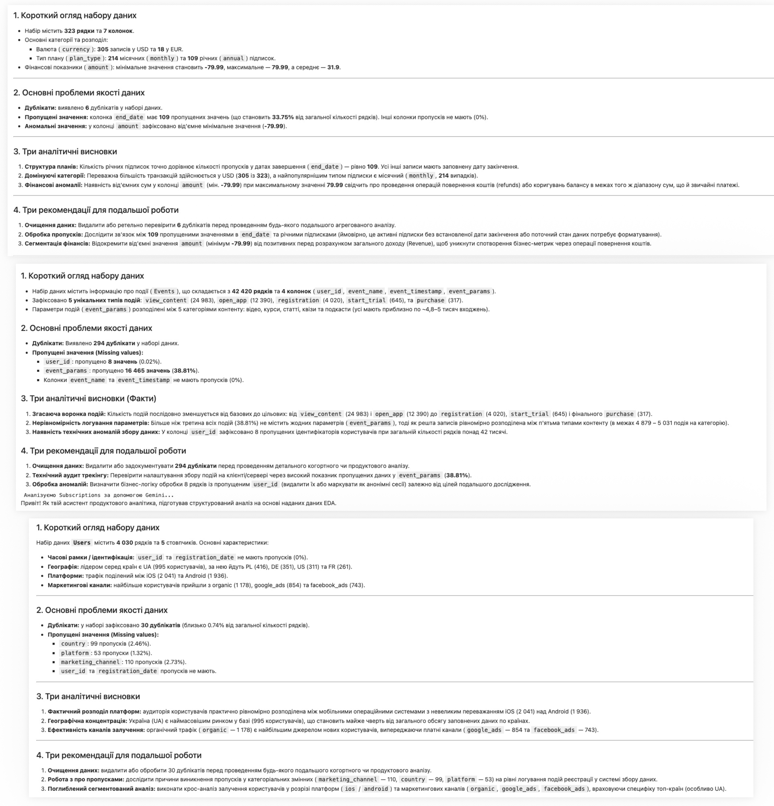
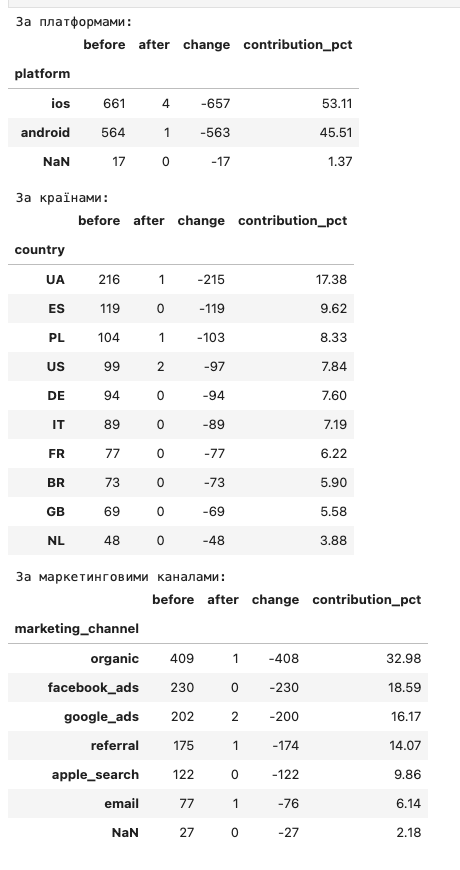
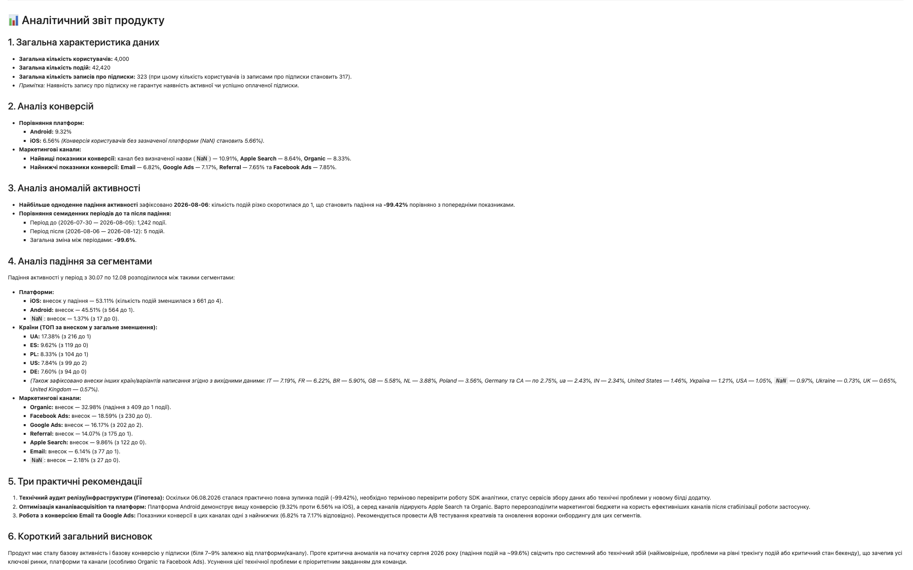
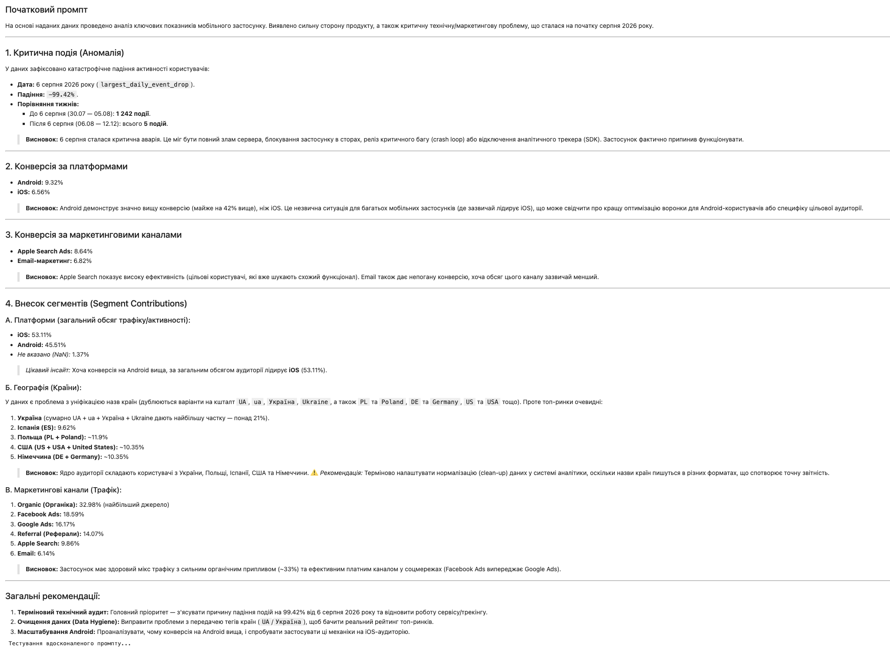
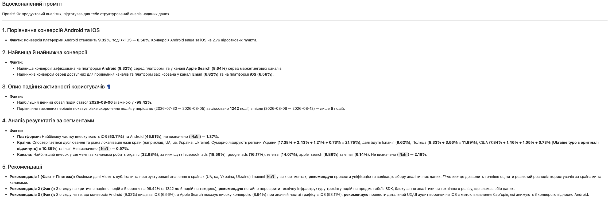
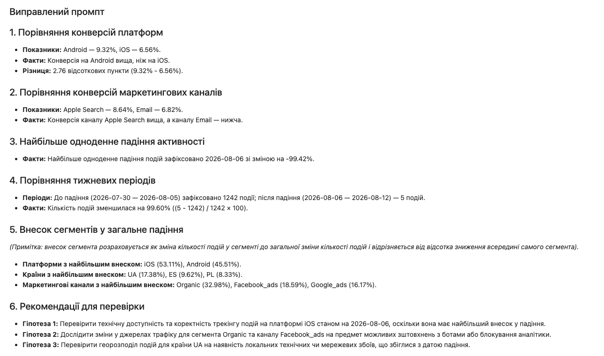

# AI Analytics Assistant

## Опис проєкту

AI-аналітичний асистент для аналізу даних користувачів мобільного застосунку.

Проєкт виконано в межах лабораторної роботи №4 студенткою групи ІС-31 Яловіца Анастасією Ігорівною.

Для розрахунків використано Python і Pandas, для інтерпретації результатів — Gemini API.

## Використані технології

- Python
- Jupyter Notebook
- Pandas
- NumPy
- Matplotlib
- Google Gemini 3.5 Flash-Lite

## Набір даних

Використано три CSV-файли:

- users.csv — 4 030 записів
- events.csv — 42 420 записів
- subscriptions.csv — 323 записи

Загалом — 46 773 записи.

## Основні функції

1. auto_eda() та ai_interpret_eda() — аналіз структури, пропусків, дублікатів та AI-інтерпретація даних.
2. suggest_hypotheses() — генерація аналітичних гіпотез на основі конверсій.
3. explain_metric_drop() — виявлення аномальних змін активності.
4. explain_segment_drop() — аналіз падіння активності за платформами, країнами та маркетинговими каналами.
5. generate_summary() — формування підсумкового AI-звіту.

## Основні результати

- 4 000 унікальних користувачів
- 42 420 подій
- 317 користувачів із записами про підписки
- Конверсія Android — 9,32%
- Конверсія iOS — 6,56%
- Найбільше одноденне падіння активності — 99,42%
- Зменшення кількості подій за два семиденні періоди — 99,60%
- Найбільший внесок у падіння: iOS — 53,11%, UA — 17,38%, Organic — 32,98%

## Демонстрація роботи

### 1. Автоматичний аналіз даних

Аналіз структури таблиць, пропущених значень, дублікатів та формування висновків за допомогою Gemini.

### 2. Аналіз аномалій

Виявлення падіння активності користувачів та порівняння показників за платформами, країнами й каналами.

### 3. Підсумковий AI-звіт

Формування загального аналітичного звіту з результатами, гіпотезами та рекомендаціями.

### Повний аналітичний звіт

За результатами роботи асистента сформовано файл ai_analytics_report.md, який містить загальну статистику, аналіз конверсій, аномалій, внеску сегментів та рекомендації для подальшої перевірки.

Повний звіт: [ai_analytics_report.md](ai_analytics_report.md)

### Документація промптів

У файлі prompts.md зібрано промпти всіх аналітичних функцій, а також три версії тестового промпта: початкову, вдосконалену та виправлену.

Наведено результати тестування, виявлені помилки та зміни, які допомогли покращити відповіді Gemini.

Документація: [prompts.md](prompts.md)

## Тестування промптів

Було протестовано три версії промпта: початкову, вдосконалену та виправлену.

Після уточнення інструкцій покращилася структура відповідей, правильність інтерпретації показників та розмежування фактів і гіпотез.

### Результати тестування промптів

Для перевірки якості AI-відповідей було протестовано три версії промпта.

#### 1. Початковий промпт

Модель сформувала розгорнутий аналіз, але припустилася неточностей і зробила непідтверджені висновки.

#### 2. Вдосконалений промпт

Покращилася структура відповіді, проте залишилися помилки в інтерпретації окремих показників.

#### 3. Виправлений промпт

Після уточнення інструкцій модель правильно розмежувала показники, визначила внесок сегментів і подала можливі причини як гіпотези.

## Інструкція запуску

1. Встановити Python та Jupyter Notebook.
2. Встановити залежності командою:

   pip install -r requirements.txt

3. Розмістити CSV-файли поряд із Notebook.
4. Відкрити Лаба4_Яловіца.ipynb.
5. Отримати API-ключ у Google AI Studio.
6. Ввести ключ.
7. Послідовно виконати комірки Notebook.

